# Ziraboard: a SaaS dashboard for users, projects and activity

Ziraboard is a small full-stack dashboard for a team that needs to manage its people, its projects and a record of who changed what. It has sign-up and sign-in, three roles with different permissions, create/edit/delete screens for projects and users, search with filters and pagination, and validation messages on every form.

- **Live demo:** https://ziraboard.vercel.app (one-click demo accounts on the sign-in page)
- **Demo video:** [ADD: YouTube or LinkedIn link]

On the live demo, use the **Try a demo account** buttons on the sign-in page to enter as an Admin, a Manager or a Member. No password is needed, and none is published anywhere.

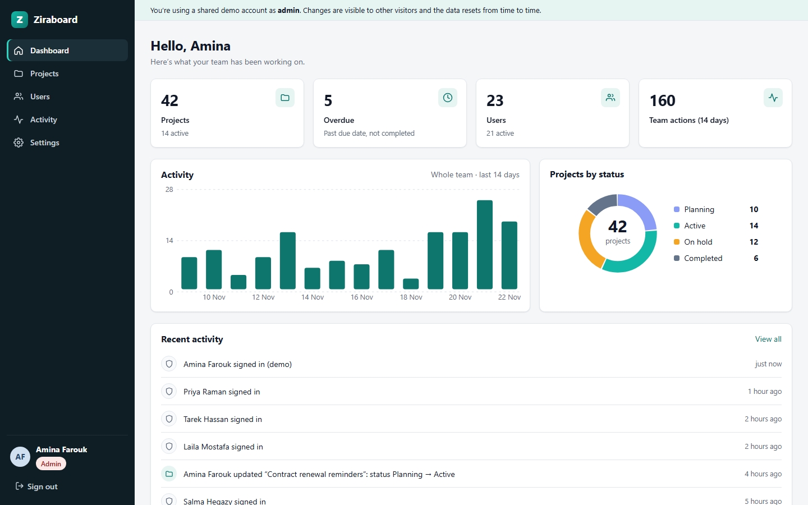

Built for the UneeQ Interns Web Development track, task "Production-Ready SaaS Dashboard".

## Task requirements and where they are met

| Requirement | How Ziraboard does it |
| --- | --- |
| Authentication and role-based access | Email and password sign-up and sign-in, sessions in an HttpOnly cookie, and three roles (Admin, Manager, Member). Every API route checks the role, and the screens hide, lock or explain actions the role can't take. |
| CRUD pages for management | Projects: create, view, edit, delete. Users (admins): add, edit, change role, suspend, delete. Your own profile and password on Settings. |
| Search, filter and pagination | Projects: text search plus status, priority and owner filters, five sort orders and page sizes of 10, 20 or 50. Users: search, role and status filters. Activity: filter by person and type. Filters live in the URL, so a filtered view survives a refresh and can be shared. |
| Form validation and error states | One set of [Zod](https://zod.dev) rules is shared by the browser and the server. Fields are checked when you leave them and again on submit, the server sends back per-field errors, and the form shows them under the right field. Lists have loading skeletons, empty states, and an error state with a retry button. |
| Deployment | Deployed on Vercel's free plan (React app plus the API as a serverless function) with a free Supabase Postgres database. A `Dockerfile` is included for other hosts, and GitHub Actions runs the tests on every push. |

| Success criterion | Evidence |
| --- | --- |
| App can be installed and run by another person | Four commands in [Getting started](#getting-started). Locally it runs PGlite, a full Postgres that ships as an npm package, so there is no database server to install and no native module to compile. Demo data loads on the first start. |
| Main flows work end-to-end | 23 automated tests drive the real API over HTTP: register, sign in, sign out, create, update and delete a project, search and paginate, suspend a user. Each flow was also checked by hand in the browser. |
| Validation and permissions are visible | See the screenshots below: locked buttons with the reason next to them, a read-only banner on projects you can't edit, a "no access" page, and a permission table on Settings that highlights your role. |

## Roles and permissions

| Action | Admin | Manager | Member |
| --- | --- | --- | --- |
| View dashboard and projects | Yes | Yes | Yes |
| Create projects | Yes | Yes | No |
| Edit and delete projects | Any project | Own projects | No |
| Reassign a project to another owner | Yes | No | No |
| View the user list | Yes | Yes (read-only) | No |
| Add, edit, suspend and delete users | Yes | No | No |
| View activity log | Everyone | Everyone | Own actions |

The rules are written once in [`shared/permissions.ts`](shared/permissions.ts). The server uses them to allow or refuse each request. The client uses the same function to decide what to show, and each project in a list response carries `canEdit` and `canDelete` flags computed by the server for the current user.

A few business rules sit on top of the table:

- You can't change your own role, suspend yourself or delete yourself.
- The team always keeps at least one active admin.
- A user who owns projects can't be turned into a Member or deleted until their projects are reassigned. The error says how many projects they own.
- Suspending someone signs them out at once.
- A completed project must be at 100% progress, and a project in Planning can't be more than 20% done.

## Screenshots

| Sign-in with demo accounts | Projects with search, filters and sort |
| --- | --- |
| 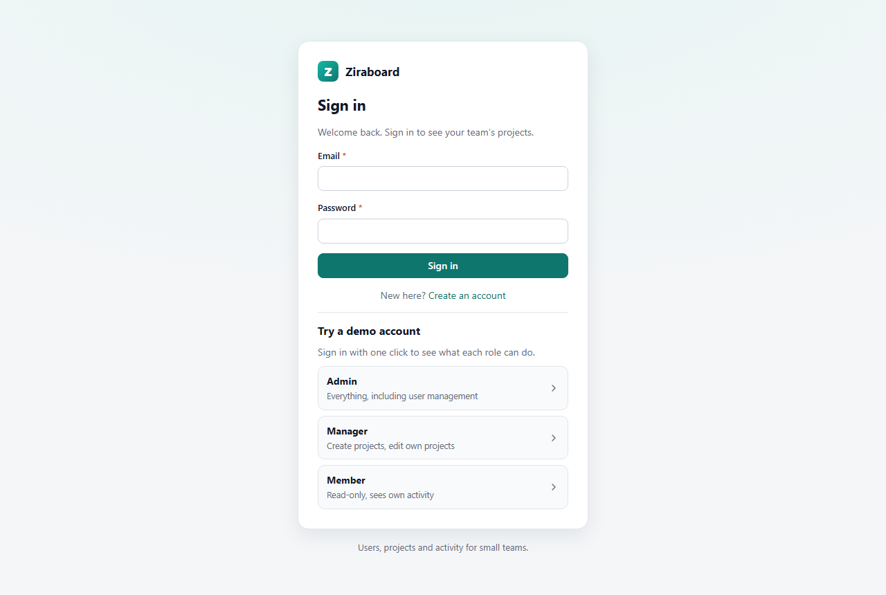 | 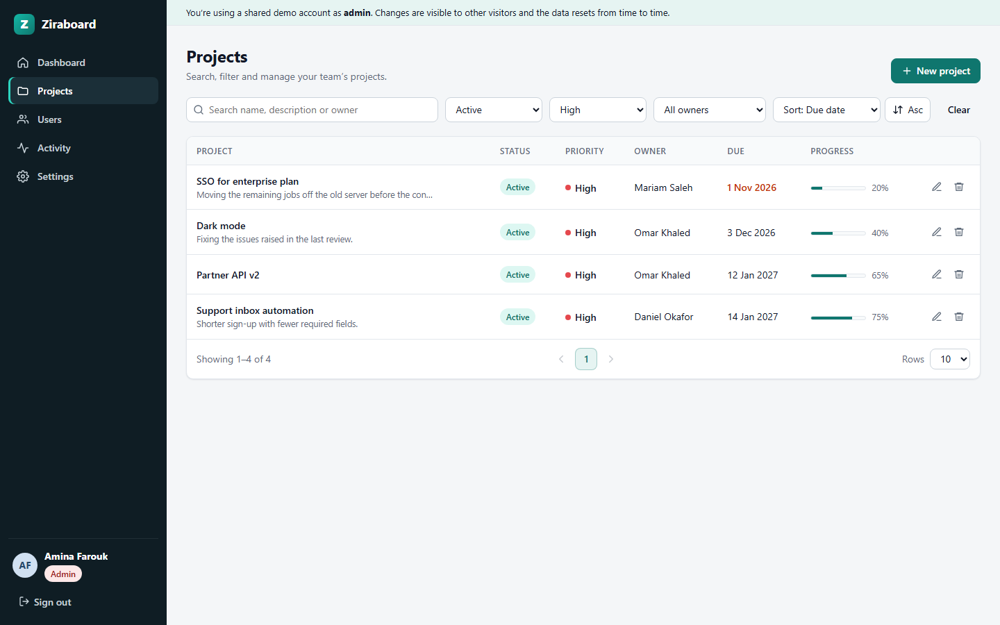 |

| Form validation | A business rule enforced by the server |
| --- | --- |
| 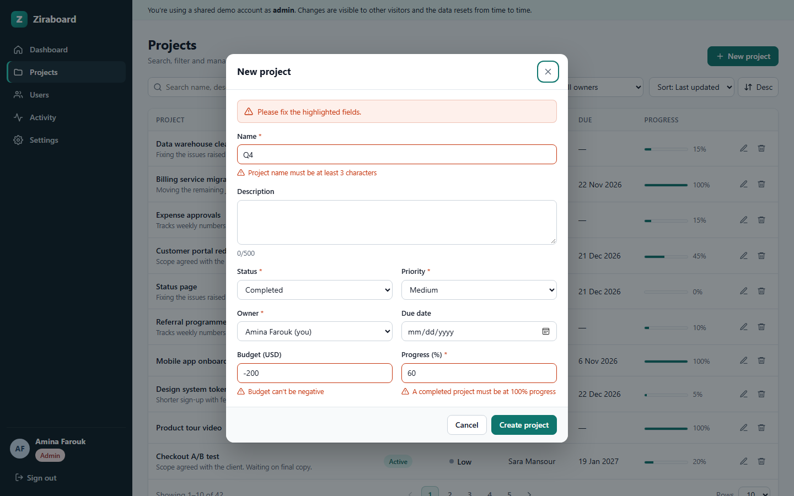 | 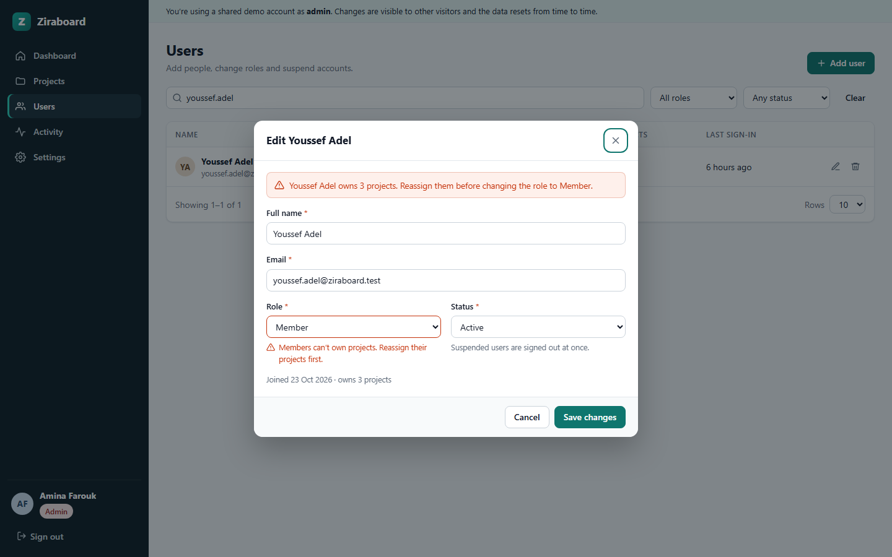 |

| Member: read-only projects | Member: no access to Users |
| --- | --- |
| 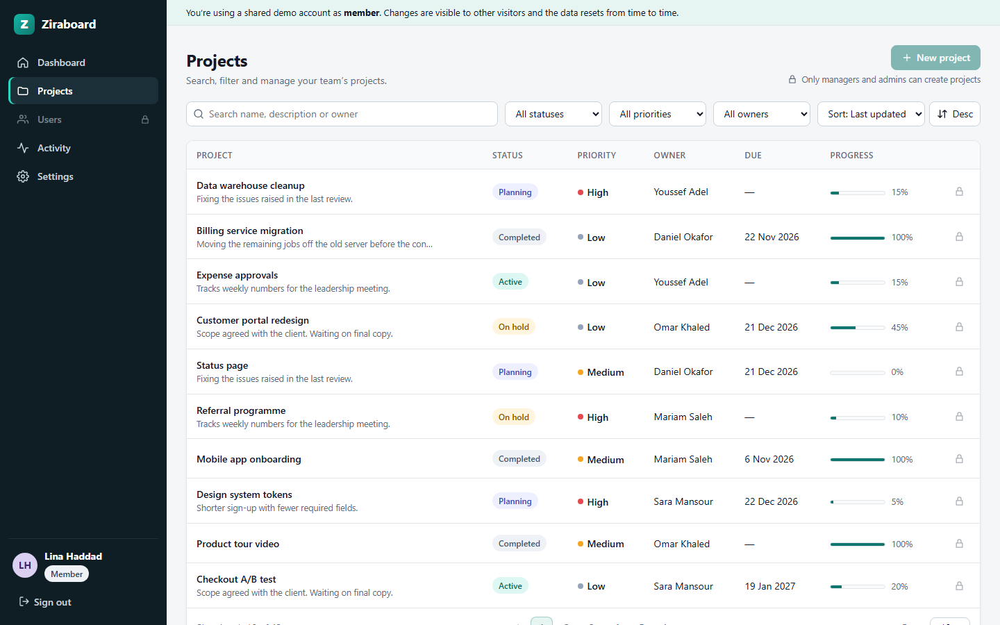 | 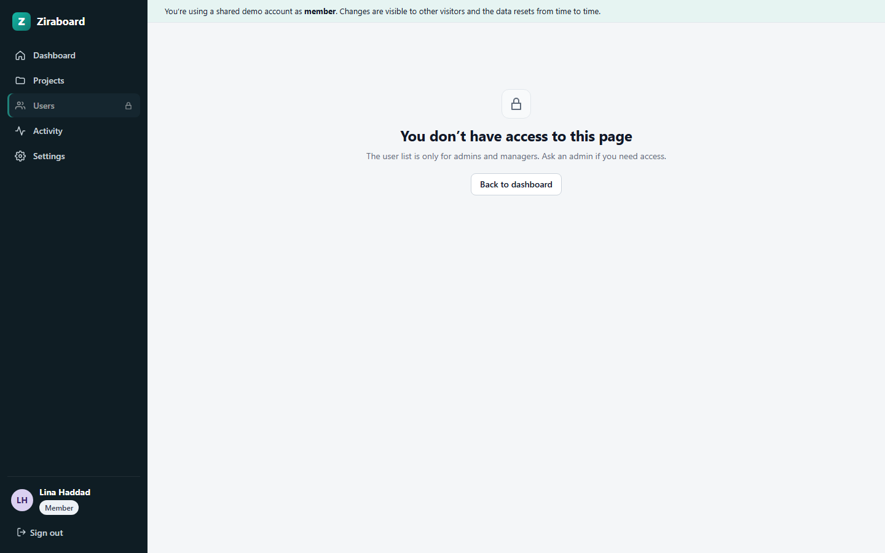 |

The Settings page shows what each role can do, with the current role highlighted:

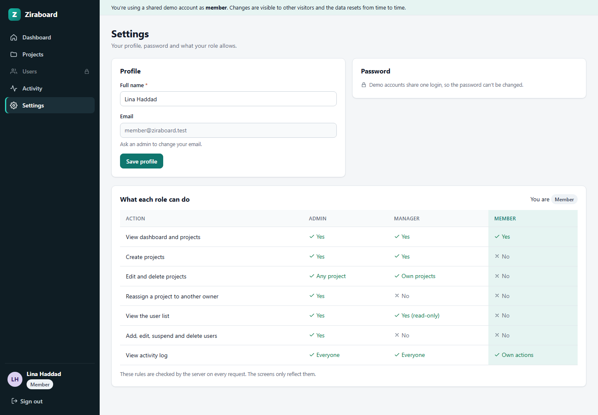

### On a phone

| Dashboard | Projects as cards | Menu |
| --- | --- | --- |
| 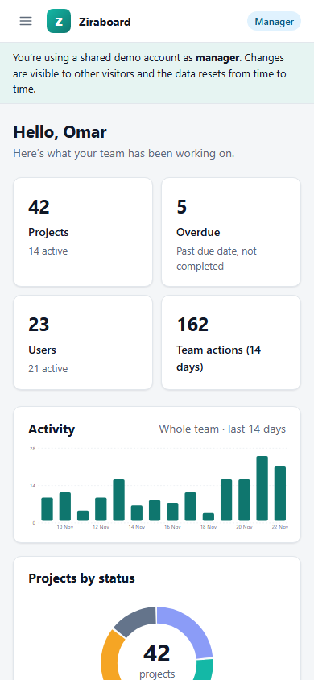 | 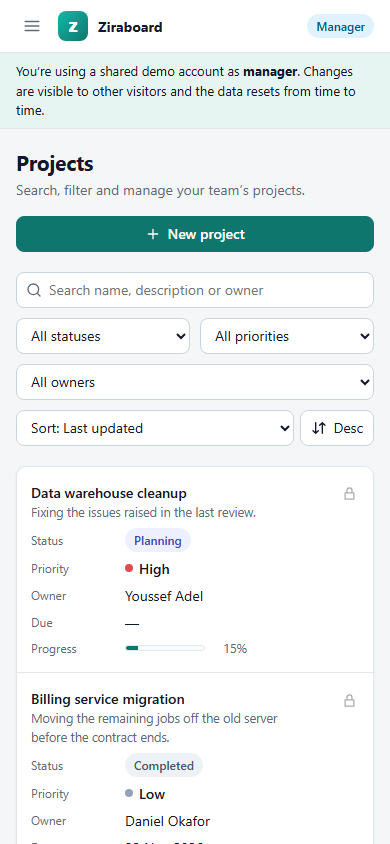 | 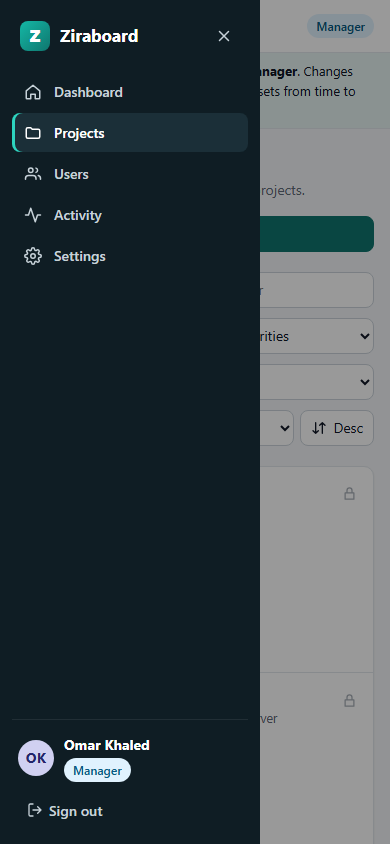 |

The app also follows the system dark mode.

## Getting started

You need Node.js 22.13 or newer (24 recommended). Nothing else.

```bash
git clone https://github.com/ziad3no/ziraboard-saas-dashboard.git
cd ziraboard-saas-dashboard
npm install
npm run dev
```

Open http://localhost:5174. The first start creates a local Postgres database in `data/pglite` (PGlite) and fills it with a demo team: 23 people, 42 projects and a month of activity. Click a demo account to sign in, or create your own account (new accounts start as Members).

To run the production build locally:

```bash
npm run build
npm start
```

Then open http://localhost:3001. In this mode the API serves the built React app as well.

| Command | What it does |
| --- | --- |
| `npm run dev` | Start the API (port 3001) and the Vite dev server (port 5174) together |
| `npm test` | Run the 23 API and permission tests (Vitest + Supertest) |
| `npm run build` | Type-check everything and build the client into `dist/` |
| `npm start` | Start the server, which also serves `dist/` |
| `npm run seed` | Wipe the local database and load the demo data again |

### Settings

All settings are optional. Copy `.env.example` to `.env` to change them. None of them is a secret.

| Variable | Default | Meaning |
| --- | --- | --- |
| `DATABASE_URL` or `POSTGRES_URL` | not set | Postgres connection string. On Vercel the Supabase integration sets `POSTGRES_URL`. When neither is set, a local PGlite database is used. |
| `PORT` | `3001` | Port for `npm start`. |
| `API_PORT` | `3001` | Port the API uses during `npm run dev`. |
| `DATA_DIR` | `./data` | Folder for the local PGlite database. |
| `DEMO_LOGIN` | `true` | Show the one-click demo accounts. Set to `false` for a private team. |
| `DEMO_RESET_HOURS` | `0` locally, `24` on Vercel | Wipe and re-seed the demo data when it is older than N hours, so the public demo stays usable. |

## Deploying

### Vercel + Supabase (free, no card)

The React app is served by Vercel, the API runs as a Vercel serverless function (`api/index.ts`, routed by `vercel.json`), and the data lives in a free Supabase Postgres database.

1. Push this repository to GitHub.
2. On [Vercel](https://vercel.com), choose **Add New → Project** and import the repository. Keep the detected settings and deploy.
3. In the Vercel project, open **Storage → Connect Database → Supabase** and create a free database. Vercel adds `POSTGRES_URL` and the other connection settings to the project for you, so no password is copied by hand.
4. Redeploy. The first request creates the tables and loads the demo data.

The public demo resets to the demo data every 24 hours (`DEMO_RESET_HOURS`). Supabase pauses a free project after a week without visits; it can be resumed from the Supabase dashboard.

### Docker

```bash
docker build -t ziraboard .
docker run -p 3000:3000 -v ziraboard-data:/data ziraboard
```

Without a database URL the container uses PGlite and keeps its data in the `/data` volume. Set `DATABASE_URL` to use an external Postgres instead.

Without a database URL the container uses PGlite and keeps its data in the `/data` volume. Set `DATABASE_URL` to use an external Postgres instead.

## How it works

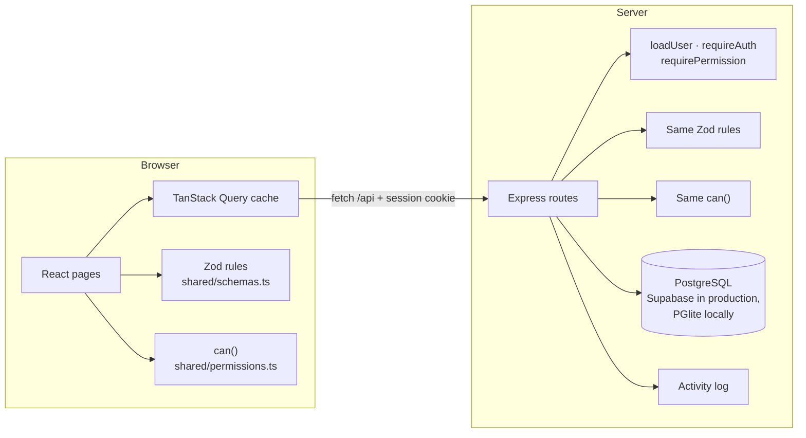

- **Client:** React 19, React Router 7 and TanStack Query, built with Vite. Lists keep the previous page on screen (faded) while the next one loads, so the table doesn't jump.
- **Server:** Express 5 with PostgreSQL: Supabase in production through `node-postgres`, and PGlite on your computer and in the tests, so the tests run against real Postgres. Every query uses bound parameters. Search text escapes `%` and `_`, so typing them doesn't act as a wildcard.
- **Shared:** `shared/` holds the validation rules, the permission function and the response types. Both sides import them, so the browser and the API can't drift apart.

### Data model

| Table | Holds | Notes |
| --- | --- | --- |
| `users` | name, email (unique, case-insensitive), password hash, role, status | `role` and `status` have CHECK constraints |
| `sessions` | SHA-256 hash of the session token, user, expiry | Deleted on sign-out, password change and suspension |
| `projects` | name, description, status, priority, owner, due date, budget, progress | `owner_id` uses ON DELETE RESTRICT, so an owner can't be deleted by accident |
| `activity` | who, what, which record, a readable summary, when | `actor_name` is copied in, so the log still reads correctly after a user is deleted |

### API

All routes are under `/api`. Every request that changes something must send the header `X-Requested-With: ziraboard`.

| Method and path | Who | Purpose |
| --- | --- | --- |
| `POST /auth/register` | anyone | Create a Member account and sign in |
| `POST /auth/login` | anyone | Sign in (8 failed tries per 15 minutes per email and IP) |
| `POST /auth/demo` | anyone, if `DEMO_LOGIN=true` | Sign in as the demo Admin, Manager or Member |
| `POST /auth/logout` | signed in | End the session |
| `GET /auth/me`, `PATCH /auth/me` | signed in | Read or rename yourself |
| `POST /auth/me/password` | signed in | Change password and sign out other sessions |
| `GET /stats` | signed in | Numbers and charts for the dashboard |
| `GET /projects` | signed in | List with `q`, `status`, `priority`, `ownerId`, `sort`, `dir`, `page`, `pageSize` |
| `POST /projects` | admin, manager | Create |
| `GET`, `PUT`, `DELETE /projects/:id` | per the permission table | Read, replace, delete |
| `GET /users` | admin, manager | List with `q`, `role`, `status`, `page`, `pageSize` |
| `GET /users/owners` | signed in | People who can own projects, for filters and forms |
| `POST /users`, `PUT`, `DELETE /users/:id` | admin | Manage users |
| `GET /activity` | signed in | Log with `actorId`, `entity`, `page` (members get only their own) |

Errors always look like `{ "error": { "message": "...", "fieldErrors": { "name": "..." } } }`, with status 400 (invalid), 401 (not signed in), 403 (not allowed), 404, 409 (conflicts with a business rule) or 429 (too many sign-in attempts).

### Project structure

```
api/
  index.ts          Vercel serverless entry point
server/
  index.ts          local start-up: open the database, seed, listen
  config.ts         settings from environment variables
  app.ts            Express app (also used by the tests)
  auth.ts           password hashing, sessions, role middleware, sign-in limiter
  db.ts             schema and helpers
  seed.ts           demo data
  routes/           auth, projects, users, activity + stats
shared/
  permissions.ts    roles and the can() function
  schemas.ts        Zod validation rules
  types.ts          API response types
src/
  pages/            Dashboard, Projects, Users, Activity, Settings, sign-in pages
  components/       layout, charts, form fields, modal, pagination, badges
  api.ts            fetch wrapper with friendly error messages
  auth.tsx          signed-in user context
  form.ts           form state on top of the shared Zod rules
tests/              API and permission tests
```

## Security

- Passwords are hashed with scrypt and a random salt. Seeded accounts store a value no password can match.
- Session tokens are 32 random bytes in an HttpOnly, SameSite=Lax cookie (Secure in production). The database stores only their SHA-256 hash.
- Writes require a custom header, which a cross-site form or image request can't add.
- Repeated failed sign-ins are slowed down, and a wrong email and a wrong password get the same message.
- Helmet sets a Content Security Policy and other security headers. JSON bodies are capped at 50 KB.
- The repository has no secrets, and the demo accounts have no passwords to leak.

## Tests

`npm test` runs 23 tests in `tests/`:

- sign-up, sign-in, sign-out, duplicate email, missing CSRF header, sign-in throttling, demo sign-in switched off
- a Member can't create, edit or delete projects; a Manager can edit only their own; a Manager can't assign a project to someone else
- the user list is closed to Members and read-only for Managers; Members see only their own activity even if they ask for someone else's
- create, update and delete with the activity entries they produce, cross-field validation, search, filters, pagination, junk query parameters
- the self-demotion, project-owner and suspension rules

## Known limitations

- The sign-in limiter lives in memory, so it resets when the server restarts and isn't shared between several servers.
- There is no email sending yet, so there is no "forgot password" flow.
- The public demo resets every 24 hours, and Supabase pauses free projects after a week without visits (see Deploying).

## Author

Ziad Mohamed Emad, UneeQ Interns, Web Development track.

[ADD: your LinkedIn profile URL]

Released under the [MIT License](LICENSE).
